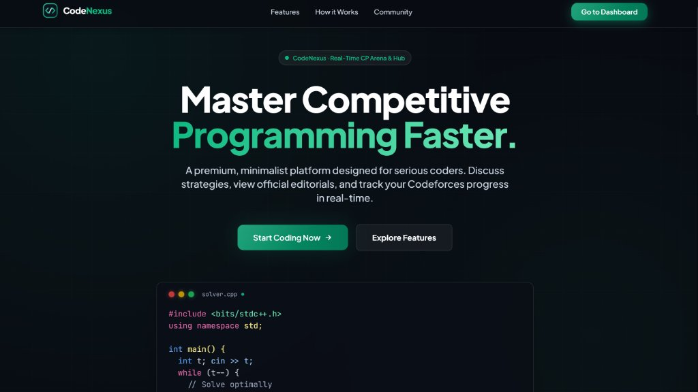
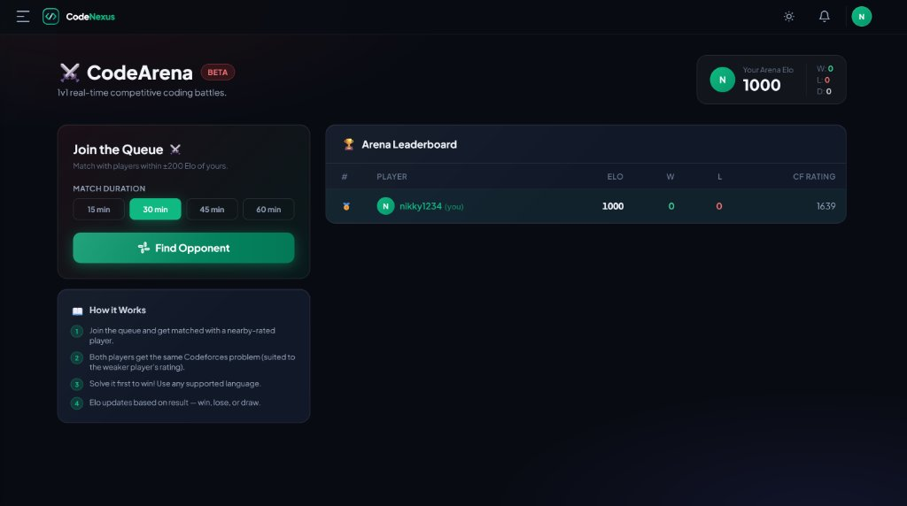

<div align="center">

# ⚡ CodeNexus

### Real-Time Competitive Programming Arena, AI Editorial Engine & Community Hub

[](https://github.com/Nikky-SDE/CodeNexus/actions/workflows/ci.yml)
[](https://codenexus-tsud.onrender.com/)
[](https://nodejs.org/)
[](https://react.dev/)
[](https://expressjs.com/)
[](https://socket.io/)
[](./LICENSE)

[**🌐 Live Application**](https://codenexus-tsud.onrender.com/) · [**🐛 Report a Bug**](https://github.com/Nikky-SDE/CodeNexus/issues) · [**✨ Request a Feature**](https://github.com/Nikky-SDE/CodeNexus/issues)

</div>

---

## 📖 Overview

**CodeNexus** is a full-stack, real-time competitive programming platform engineered for algorithmic problem-solvers. Built as an npm workspace monorepo on **React 19**, **Express 5**, **Socket.IO**, and **MongoDB Atlas**, it bridges the gap between solo practice and live competition.

CodeNexus pairs verified programmers in live 1v1 lockout duels (**CodeArena**), automates zero-credential **Codeforces handle ownership verification**, extracts and transforms official tutorials into **AI-generated progressive hints**, provides an integrated **multi-language code execution sandbox**, and hosts a **KaTeX-enabled technical discussion feed**.

---

## 🖼️ Platform Preview

| **Landing Page & Hero Preview** | **CodeArena (1v1 Live Matchmaking & Leaderboard)** |
| :---: | :---: |
|  |  |
| *Minimalist dark-UI landing page with live C++ syntax preview* | *Real-time ±200 Elo matchmaking queue (15/30/45/60m) & live standings* |

---

## ✨ Key Features

- ⚔️ **CodeArena (1v1 Live Lockout Duels):** Real-time WebSocket matchmaking within ±200 Elo across 15, 30, 45, and 60-minute time controls. Dynamically selects rating-calibrated Codeforces problems (matched to the lower-rated player's tier) and verifies winning submissions automatically.
- 🔐 **Zero-Password Codeforces Verification & Sync:** Cryptographically verifies Codeforces account ownership via timed Compilation Error (CE) submission challenges, backed by an automated `node-cron` pipeline that synchronizes user ratings and rank badges daily.
- 🧠 **Wing Editorials & AI Progressive Hints:** Combines curated community editorials with an SSRF-hardened Cheerio + Google Gemini pipeline that parses official Codeforces tutorials into 4–8 progressive, spoiler-free hints.
- 💻 **Multi-Language Code Playground:** In-browser compilation and execution for **C++17, C, Python 3, Java, and JavaScript** powered by Judge0 CE, complete with custom `stdin`/`stdout` inspection.
- 💬 **Technical Community Hub & Discussions:** Rich-text discussion threads supporting GitHub-flavored Markdown, **KaTeX** mathematical typesetting, syntax-highlighted code blocks, `@mentions` autocomplete, and real-time notifications.
- 📅 **Contests Hub & Rating Recommender:** Tracks upcoming and past competitive programming rounds with dedicated discussion channels and personalized problem recommendations calibrated to your Codeforces rating.
- 📨 **Direct Messaging & Role-Based Moderation:** Low-latency 1-on-1 real-time chat over Socket.IO, coupled with administrative moderation controls and token-bucket IP rate limiting.

---

## 🧠 Core Engineering & Algorithms

### 1. Elo Rating & Matchmaking Engine (`arenaController.js` & `server.js`)
- **Matchmaking Queue:** Pairs verified users in real time within a **±200 Elo** window across customizable match durations (`15m`, `30m`, `45m`, `60m`).
- **Mathematical Rating Update:** Implements the standard Elo rating system with a $K$-factor of **32**. Given player ratings $R_{\text{user}}$ and $R_{\text{opponent}}$, the expected score $E$ is computed as:
  $$E = \frac{1}{1 + 10^{(R_{\text{opponent}} - R_{\text{user}}) / 400}}$$
- **Atomic State Resolution:** Upon detecting an `OK` (Accepted) verdict or timer expiration, rating deltas $\Delta R = K \cdot (S - E)$ are atomically persisted to MongoDB (`arenaWins`, `arenaLosses`, `arenaElo`) and broadcast to both clients.

### 2. Zero-Credential Codeforces Handle Verification (`verifyController.js`)
- Eliminates OAuth/password dependency on third-party competitive sites through a deterministic **Compilation Error (CE) Challenge**.
- Issues a unique token challenge prompting the user to submit a deliberate Compilation Error snippet to a specified problem within a strict **60-second** window.
- Polls `user.status` on the official Codeforces API, verifying submission timestamp, problem ID, and `COMPILATION_ERROR` verdict before binding the handle to the user's profile.

### 3. SSRF-Safe Progressive AI Hints Pipeline (`aiEditorials.js`)
- **Secure Scraping:** Uses **Cheerio** to parse official Codeforces editorial blogs while enforcing strict HTTPS protocol checks and hostname allowlisting to prevent Server-Side Request Forgery (SSRF).
- **Pedagogical Prompt Engineering:** Pipes the extracted editorial context into **Google Gemini (Flash / Pro)** to synthesize **4 to 8 progressive hints**—graduating from high-level intuition and invariant observations to concrete algorithmic complexity—without spoiling the final code implementation.

### 4. Custom HTML5 History SPA Router & Auto-Recovery (`navigation.js`)
- Lightweight, zero-dependency Single Page Application (SPA) router built directly on the native HTML5 History API (`pushState`, `replaceState`, and `popstate` listeners).
- **Loop-Free Auth Guards:** Intercepts unauthenticated navigation attempts, sanitizes target paths into a `?next=` query parameter via `history.replaceState`, and restores the exact destination post-login without polluting the browser's Back/Forward stack.

---

## 🏗️ System Architecture & Performance

```text
┌──────────────────────────────────────────────────────────────────────────┐
│                        Client Layer (React 19 + Vite 5)                  │
│   Custom History Router • KaTeX & Markdown • Socket.IO Client • Gemini   │
└───────────────────┬──────────────────────────────────┬───────────────────┘
                    │ REST API (HTTPS / JSON)          │ WebSockets (Sub-50ms)
                    ▼                                  ▼
┌──────────────────────────────────────────────────────────────────────────┐
│                     Application Server (Node.js 22 + Express 5)          │
│     Token-Bucket Rate Limiter • JWT Cookie Auth • Socket.IO 4 Server     │
└─────┬──────────────────┬──────────────────┬──────────────────┬───────────┘
      │ Mongoose 8       │ REST / Cheerio   │ REST API         │ Cron (Daily)
      ▼                  ▼                  ▼                  ▼
┌──────────────┐  ┌─────────────────┐  ┌──────────────┐  ┌─────────────────┐
│ MongoDB Atlas│  │ Codeforces API  │  │ Judge0 CE API│  │ Rating Sync Job │
│  (Database)  │  │ (Verify & Parse)│  │  (Sandbox)   │  │ (300/batch,1.2s)│
└──────────────┘  └─────────────────┘  └──────────────┘  └─────────────────┘
```

### Performance Highlights
- **Non-Blocking Asynchronous I/O:** Built on **Node.js 22** and **Express 5** for high-concurrency request handling and native promise error forwarding.
- **Sub-50ms Real-Time State Sync:** Dedicated **Socket.IO 4** rooms power instant 1v1 CodeArena state transitions, live lobby queues, and direct messaging.
- **Sub-2s Time to Interactive (TTI):** **React 19** and **Vite 5** bundle optimization with dynamic route chunking, keeping initial payload sizes minimal despite heavy math (`KaTeX`) and syntax-highlighting dependencies.
- **Rate-Limit-Safe Cron Throttling:** Background `node-cron` worker (`syncCfRatings.js`) synchronizes Codeforces ratings in batches of **300 users** with a strict **1.2-second inter-request delay**, preventing upstream HTTP 429 bans.

---

## 🛠️ Tech Stack

| Layer | Technologies |
| :--- | :--- |
| **Frontend** | React 19, Vite 5, Tailwind CSS 3, Socket.IO Client, React Markdown, KaTeX, React Syntax Highlighter, Custom HTML5 History Router |
| **Backend** | Node.js 22 (ESM), Express 5, Socket.IO 4, Mongoose 8, JWT (`cookie-parser`), `bcryptjs`, Cheerio, `node-cron`, `nodemailer` |
| **Database** | MongoDB Atlas |
| **External APIs** | Codeforces API, Judge0 CE API, Google Gemini API (Flash / Pro), Google OAuth 2.0 |
| **Testing & DevOps** | Node.js 22 Native Test Runner (`node --test`), GitHub Actions CI, Render (`render.yaml` IaC Blueprint) |

---

## 📂 Repository Structure

CodeNexus is structured as an **npm workspace monorepo**:

```text
CodeNexus/
├── backend/
│   ├── controllers/      # Route handlers: auth, post, comment, editorial, contest, arena, users, chat, verify
│   ├── models/           # Mongoose schemas: User, Post, Comment, Contest, ArenaMatch, Message, Notification, OTP
│   ├── routes/           # Express 5 modular REST API endpoints
│   ├── middleware/       # JWT HTTP-only cookie verification & token-bucket IP rate limiter
│   ├── utils/            # Helpers: jwt, sanitize, mentions parser, sendEmail, aiEditorials
│   ├── jobs/             # syncCfRatings (throttled daily cron job for Codeforces rating sync)
│   ├── tests/            # Unit & integration test suites (Node.js 22 built-in test runner)
│   └── server.js         # Entry point: HTTP server + Express 5 app + Socket.IO real-time engine
├── frontend/
│   ├── src/
│   │   ├── pages/        # Views: LandingPage, HubPage, AuthPage, EditorialsPage, ArenaPage, ContestsPage, etc.
│   │   ├── components/   # Reusable UI: Navbar, SideMenu, PostCard, MarkdownRenderer, MentionsTextarea, etc.
│   │   ├── utils/        # navigation (HTML5 History API SPA router), cfRank color/tier mappings
│   │   ├── App.jsx       # Root SPA component with popstate listeners and global auth state
│   │   └── main.jsx      # React 19 DOM entry point
│   ├── index.html
│   └── vite.config.js
├── render.yaml           # Render Infrastructure-as-Code (IaC) deployment blueprint
└── package.json          # Monorepo workspace root (manages backend & frontend workspaces)
```

---

## 🚀 Local Setup & Installation

### Prerequisites
- **Node.js** `v20.0.0+` (`v22 LTS` recommended for the native test runner)
- **MongoDB** (Local instance or [MongoDB Atlas](https://www.mongodb.com/atlas) cluster)
- **npm** `v10+` (for workspace support)

### Step-by-Step Installation

1. **Clone the repository**
   ```bash
   git clone https://github.com/Nikky-SDE/CodeNexus.git
   cd CodeNexus
   ```

2. **Install monorepo dependencies**
   ```bash
   npm install
   ```

3. **Configure environment variables**
   Copy `.env.example` to `.env` (or configure `backend/.env` and `frontend/.env` as needed) and populate the values listed in the [Environment Variables](#-environment-variables) section below.

4. **Start the development servers**
   ```bash
   # Terminal 1 — Start Backend API & Socket.IO server (http://localhost:5000)
   npm run dev

   # Terminal 2 — Start Frontend Vite dev server (http://localhost:5173)
   npm run dev:frontend
   ```

5. **Run linter, test suites, and production build**
   ```bash
   npm run lint
   npm test
   npm run build --workspace=frontend
   ```

---

## 🔑 Environment Variables

| Variable | Scope | Required? | Default / Fallback | Description |
| :--- | :--- | :--- | :--- | :--- |
| `PORT` | Backend | Optional | `5000` | Port on which the Express & Socket.IO server listens |
| `NODE_ENV` | Backend | Optional | `development` | Environment mode (`development` or `production` to serve `frontend/dist`) |
| `MONGODB_URI` | Backend | **Required** | `mongodb://localhost:27017/codenexus` | MongoDB Atlas or local connection string |
| `JWT_SECRET` | Backend | **Required (Prod)** | Randomly generated in dev | Cryptographic secret used to sign 7-day HTTP-only session cookies |
| `CLIENT_URL` | Backend | Optional | `http://localhost:5173` | Trusted frontend origin allowed by Express & Socket.IO CORS policies |
| `GOOGLE_CLIENT_ID` | Backend | Optional | `""` *(Google Auth disabled)* | Google OAuth 2.0 Client ID for backend ID-token verification |
| `VITE_GOOGLE_CLIENT_ID` | Frontend | Optional | `""` | Google OAuth 2.0 Client ID exposed to the Vite frontend client |
| `VITE_API_URL` | Frontend | Optional | `""` *(Same-origin)* | Base backend URL when hosting frontend and backend on separate domains |
| `JUDGE0_URL` | Backend | Optional | `https://ce.judge0.com` | Base endpoint for Judge0 CE code execution engine |
| `JUDGE0_API_KEY` | Backend | Optional | `""` *(Mock fallback)* | RapidAPI / Judge0 authentication token for live code execution |
| `SMTP_HOST` | Backend | Optional | `""` | SMTP server hostname for OTP and transactional emails |
| `SMTP_PORT` | Backend | Optional | `587` | SMTP port (`465` for SSL, `587` for TLS) |
| `SMTP_SECURE` | Backend | Optional | `false` | Set to `true` if using port `465`, otherwise `false` |
| `SMTP_USER` | Backend | Optional | `""` | SMTP authentication username |
| `SMTP_PASS` | Backend | Optional | `""` | SMTP authentication password / app password |
| `SMTP_FROM` | Backend | Optional | `""` | Sender identity (`"CodeNexus <noreply@yourdomain.com>"`) |

---

## ☁️ Deployment (Render Blueprint)

CodeNexus is deployed in production at **[https://codenexus-tsud.onrender.com/](https://codenexus-tsud.onrender.com/)** and includes a declarative [`render.yaml`](./render.yaml) Infrastructure-as-Code configuration:

1. Fork or push this repository to your GitHub account.
2. In the [Render Dashboard](https://dashboard.render.com/), click **New → Blueprint** (or **New → Web Service**) and connect the repository.
3. Render automatically applies the build and runtime settings:
   - **Build Command:** `npm install && npm run build --workspace=frontend`
   - **Start Command:** `npm start`
   - **Health Check Endpoint:** `/api/health`
4. Populate your production secrets (`MONGODB_URI`, `JWT_SECRET`, `NODE_ENV=production`, etc.) in the Render **Environment** tab and trigger a deploy.

---

## 🗺️ Project Roadmap

- [ ] **Team Duels & Virtual Lobbies:** Multi-user ICPC-style team lockouts and custom private room codes.
- [ ] **Cross-Platform Profile Sync:** Automated rating and problem-solve aggregation for **LeetCode** and **AtCoder**.
- [ ] **Automated Anti-Cheat Engine:** AST-based code similarity detection and tab-focus telemetry inside CodeArena.
- [ ] **Community Editorial Bounties:** Upvoting, reputation badges, and bounty rewards for top-voted Wing Editorials.

---

## 🤝 Contributing Guide

Contributions, bug reports, and feature requests are welcome!

### Development Workflow
1. **Prerequisites:** Ensure you have **Node.js 20+** and a running **MongoDB** instance.
2. **Fork & Clone:** Fork the repository and create your feature branch:
   ```bash
   git checkout -b feat/your-feature-name
   ```
3. **Install & Run:**
   ```bash
   npm install
   npm run dev
   ```
4. **Verify Code Quality:** Ensure all tests and linters pass and the frontend builds cleanly before opening a Pull Request:
   ```bash
   npm run lint
   npm test
   npm run build --workspace=frontend
   ```
5. **Pull Request Guidelines:**
   - Follow existing ES Module (`import`/`export`) and async/await conventions.
   - Keep controllers modular and validate external inputs in middleware/utils.
   - Include unit or integration tests in `backend/tests/` for new API routes or algorithmic logic.

---

## 📄 License

Distributed under the **MIT License**. Copyright (c) 2026 **Nikky**. See [`LICENSE`](./LICENSE) for full license text.

---

<div align="center">

**Engineered by [Nikky](https://github.com/Nikky-SDE)**  
If you found CodeNexus useful, consider giving the repository a ⭐!

</div>
